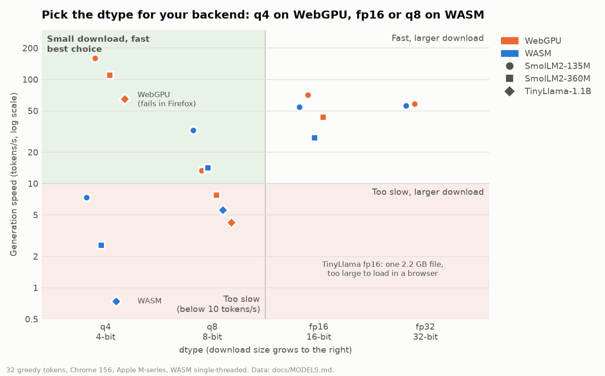

# Models for `lmlite`

This file lists browser-friendly models that are good candidates for `lmlite` (Transformers.js v4 runtime).

`lmlite` accepts either:
- full model IDs (for example: `Xenova/gpt2`, `my-org/my-model`)
- short names (for example: `gpt2`), which default to `Xenova/<name>`

## Semantic similarity (embeddings)

1. [`Xenova/all-MiniLM-L6-v2`](https://huggingface.co/Xenova/all-MiniLM-L6-v2)  
   Lightweight English sentence embeddings for semantic search, similarity ranking, and grouping short texts. A good starting point for browser demos where download size and latency matter. It represents meaning rather than generating answers; long documents should be split into shorter passages.
2. [`Xenova/all-mpnet-base-v2`](https://huggingface.co/Xenova/all-mpnet-base-v2)  
   English sentence embeddings for semantic retrieval and similarity ranking when quality matters more than model size. It generally offers stronger embeddings than MiniLM at the cost of a larger download, more memory, and slower inference. Compare retrieval results on your own data before choosing it; it is not a multilingual default. Avoid its q8 weights: they average `0.1` cosine error against fp32 (see [NATIVE.md](NATIVE.md)); use `embedding_dtype="fp16"`.

### Embedding dtype selection

`LLM.create(embedding_model=..., embedding_dtype="q8")` selects that embedding
dtype only, without retrying another variant if loading fails. When
`embedding_dtype` is omitted or `None`, Transformers.js chooses its default dtype.
The generation/classification settings `dtype` and `dtype_fallbacks` never
override this setting; `backend` also applies only to generation/classification.
Use `embedding_backend="wasm"` or `"webgpu"` to select the embedding device
independently. The default, `None`, retains Transformers.js's default device
selection and does not inherit `backend`. Unsupported device/model/dtype
combinations fail initialization without retrying on another backend.

```python
from lmlite import LLM

llm = await LLM.create(
    embedding_model="Xenova/all-MiniLM-L6-v2",
    embedding_dtype="q8",
)
vector = await llm.embed("A short sentence to compare.")
```

Choose a dtype actually supported by the model's ONNX export and runtime. For
hosted models, include the matching weights and any external data files in the
bundle; `embedding_dtype="q8"` typically selects `onnx/model_quantized.onnx`,
while `"fp32"` typically selects `onnx/model.onnx`. Missing required files fail
loading rather than falling back to a different dtype or Hub copy.

`embed()` uses attention-mask-weighted mean pooling and L2 normalization to return
a flat sentence vector. When comparing browser embeddings against precomputed
vectors, match the model snapshot, weights/dtype, tokenizer, input preparation,
pooling, and normalization. Follow model-card requirements for prefixes such as
E5's `query: ` and `passage: `; lmLite does not add these automatically.
Pinning dtype reduces one source of drift, but does not guarantee bit-identical
results across runtimes. Regenerate stored vectors and recalibrate thresholds
when changing these settings.

## Text classification

1. [`Xenova/distilbert-base-uncased-finetuned-sst-2-english`](https://huggingface.co/Xenova/distilbert-base-uncased-finetuned-sst-2-english)  
   English sentiment classifier with `POSITIVE` and `NEGATIVE` labels, useful for quick demos on reviews or short feedback. Its training is based on movie-review sentiment, so performance may differ on other domains. It has no neutral label and should not be used as a general-purpose topic classifier.
2. [`Xenova/bert-base-multilingual-uncased-sentiment`](https://huggingface.co/Xenova/bert-base-multilingual-uncased-sentiment)  
   Product-review sentiment classifier that predicts one to five stars for English, Dutch, German, French, Spanish, and Italian text. Useful for multilingual review-rating demos rather than binary sentiment. It is heavier than DistilBERT; star ratings should not be treated as reliable measures for unrelated domains or unsupported languages.
3. [`Xenova/toxic-bert`](https://huggingface.co/Xenova/toxic-bert)  
   English comment classifier for toxicity-related labels such as toxic, obscene, threat, insult, and identity hate. Useful for exploring moderation signals, not for automatically deciding whether a person or comment is harmful. Labels can overlap, and predictions can be biased or miss context; use human review for consequential decisions.

Use these with:

```python
llm = await LLM.create(classification_model="toxic-bert")
labels = await llm.classify("example text", top_k=2)
```

## Task pipelines (for `LLM.pipeline(task, model=...)`)

Transformers.js only runs models with ONNX weights and a browser-supported architecture. Models in the `Xenova` and `onnx-community` namespaces usually work. These models are covered by the opt-in `task-smoke` browser test on WASM and WebGPU:

1. [`Xenova/mobilebert-uncased-mnli`](https://huggingface.co/Xenova/mobilebert-uncased-mnli) (`zero-shot-classification`)
   Small English NLI model that scores arbitrary candidate labels. It is fast enough for interactive demos. Short, distinct labels work best, and scores are relative to the labels you supply, not calibrated probabilities. For better accuracy, use larger NLI models such as `Xenova/distilbert-base-uncased-mnli` or `Xenova/nli-deberta-v3-xsmall`.
2. [`Xenova/opus-mt-en-fr`](https://huggingface.co/Xenova/opus-mt-en-fr) (`translation`)
   Compact Marian model for one language pair. Other pairs use the same naming (`Xenova/opus-mt-<src>-<tgt>`). Multilingual models such as `Xenova/nllb-200-distilled-600M` take `src_lang`/`tgt_lang` arguments, but they are much larger.
3. [`Xenova/whisper-tiny.en`](https://huggingface.co/Xenova/whisper-tiny.en) (`automatic-speech-recognition`)
   English-only Whisper speech recognition model, about 40 MB quantized. `Xenova/whisper-tiny` and `Xenova/whisper-base` are multilingual, and accept `language` and `task="translate"` arguments. Larger Whisper models are more accurate, but slow and memory-heavy in a browser.

## Text generation (for `LLM.create(generator_model=...)`)

1. [`Xenova/gpt2`](https://huggingface.co/Xenova/gpt2)  
   English text-completion model for continuing a supplied passage, exploring sampling settings, and demonstrating browser inference. It is not instruction-tuned: a question or command may be continued rather than answered. Expect repetition and invented facts; it is a baseline for generation demos, not a reliable assistant.
2. [`Xenova/distilgpt2`](https://huggingface.co/Xenova/distilgpt2)  
   Smaller, distilled GPT-2 variant for lightweight English text-completion demos where download size and inference cost matter. It trades generation quality for a smaller model and shares GPT-2's lack of instruction tuning. Prefer it for simple continuation experiments, not factual question answering or structured extraction.
3. [`Xenova/TinyLlama-1.1B-Chat-v1.0`](https://huggingface.co/Xenova/TinyLlama-1.1B-Chat-v1.0)  
   Compact LLaMA-family chat model for conversational responses and simple instruction-following experiments. At 1.1 billion parameters it still needs substantially more browser memory than GPT-2 or SmolLM2-360M; download size depends on the chosen ONNX dtype. Use the model's intended chat format for best results, and expect limitations in reasoning and factual accuracy.
4. [`HuggingFaceTB/SmolLM2-360M-Instruct`](https://huggingface.co/HuggingFaceTB/SmolLM2-360M-Instruct)  
   Compact instruction-tuned model for lightweight English tasks such as short responses, simple rewriting, and basic extraction or classification through prompts. Its small size makes it a candidate for browser demos with limited memory. The `model_q4.onnx` variant shown below is the fastest on WebGPU but slow on WASM; see [Generation dtype selection](#generation-dtype-selection). Do not rely on it for complex reasoning, factual accuracy, or consistently valid structured output; validate generated results.

### Generation dtype selection

The fastest dtype depends on the backend, and the two backends want opposite choices:

- **WebGPU: use `q4`.** It is the fastest variant on every model measured (`q4f16`, where available, was as fast), 10 to 15× faster than `q8`. `q8` is the slowest WebGPU choice, slower than `q8` on WASM, yet it is first in the default fallback order: pass `dtype="q4"` with `backend="webgpu"`. Firefox cannot run 4-bit models on WebGPU (its 9-storage-buffer limit is one short of what the kernels need); use `fp16` there.
- **WASM: avoid `q4`.** WASM 4-bit kernels are 4 to 8× slower than `q8` and 7 to 11× slower than `fp16`. Use `fp16` when the model's fp16 file is under 2 GB (it runs as fast as fp32 at half the download), otherwise `q8`, which is first in the default fallback order. A single file over 2 GB cannot load in a browser at all (`ArrayBuffer size exceeds the supported range`).

<picture>
  <source media="(prefers-color-scheme: dark)" srcset="generation-dtype-speed-dark.png">
  
</picture>

The chart is regenerated with `uv run scripts/plot_generation_dtypes.py`. The same data:

Seconds to generate 32 greedy tokens in Chrome 156 on an Apple M-series Mac (WASM single-threaded, models served locally, so download time is excluded). Sizes in parentheses are the q4 / q8 / fp16 / fp32 files:

| model | backend | `q4` | `q8` | `fp16` | `fp32` |
|---|---|---|---|---|---|
| SmolLM2-135M-Instruct (182 / 137 / 270 / 540 MB) | WASM | 4.35 | 0.98 | **0.59** | 0.57 |
| | WebGPU | **0.20** | 2.39 | 0.45 | 0.55 |
| SmolLM2-360M-Instruct (388 / 365 / 725 MB) | WASM | 12.5 | 2.25 | **1.16** | |
| | WebGPU | **0.29** | 4.12 | 0.74 | |
| TinyLlama-1.1B-Chat (910 / 1101 / 2200 MB) | WASM | 43.1 | **5.72** | too large | |
| | WebGPU | **0.49** | 7.58 | too large | |

The WASM pattern is the same in other browsers. SmolLM2-135M on WASM takes 4.9 / 1.0 / 0.69 / 0.61 s in Safari 26.6 and 4.6 / 1.2 / 0.58 / 0.56 s in Firefox 159 (q4 / q8 / fp16 / fp32). On WebGPU, Safari takes 0.58 s with `q4` and 5.8 s with `q8`. The sizes give one more reason to skip 4-bit on WASM: these `q4` files are not much smaller than `q8`, and for SmolLM2-360M they are larger.

## Downloading and bundling models

Use `LLM.chat(messages)` for conversational models. Transformers.js applies the
chat template from the loaded tokenizer configuration; lmLite returns only the
assistant response. Include the model's `tokenizer_config.json` when hosting or
bundling assets. If no template is present, chat uses generic role labels rather
than a guessed model-specific format. Template errors and unsupported roles are
surfaced, not silently replaced with generic formatting.

The `hf` Pixi task downloads files into `models/<namespace>/<model>/`. Without a file selection it downloads the complete repository, including all ONNX variants, which can be much larger than necessary. Pass filenames after `--` to download only the assets for the dtype you intend to use.

### Minimal GPT-2 download (fp32)

Download the configuration, tokenizer, and one fp32 ONNX model (about 501 MB of weights):

```bash
pixi run hf Xenova/gpt2 -- \
  config.json generation_config.json \
  tokenizer.json tokenizer_config.json \
  onnx/model.onnx
```

Load with `generator_model="Xenova/gpt2", dtype="fp32"`. You do not need the older `decoder_*` files or other ONNX variants.

### Minimal DistilGPT-2 download (fp32)

Download the configuration, tokenizer, and one fp32 ONNX model:

```bash
pixi run hf Xenova/distilgpt2 -- \
  config.json generation_config.json \
  tokenizer.json tokenizer_config.json \
  onnx/model.onnx
```

Load with `generator_model="Xenova/distilgpt2", dtype="fp32"`. As with GPT-2, the older `decoder_*` files and other ONNX variants are not needed.

### Minimal TinyLlama download (q4)

Download the configuration, tokenizer, and one q4 ONNX model (about 910 MB of weights):

```bash
pixi run hf Xenova/TinyLlama-1.1B-Chat-v1.0 -- \
  config.json generation_config.json \
  tokenizer.json tokenizer_config.json \
  onnx/model_q4.onnx
```

Load with `generator_model="Xenova/TinyLlama-1.1B-Chat-v1.0", dtype="q4"`. This variant does not require a separate `.onnx_data` file. The q4 variant has not been confirmed by the earlier browser smoke run, which used the default dtype fallback order.

### Minimal SmolLM2 download (q4)

q4 suits `backend="webgpu"`. For WASM, download `onnx/model_fp16.onnx` instead and pass `dtype="fp16"` (see [Generation dtype selection](#generation-dtype-selection)).

```bash
pixi run hf HuggingFaceTB/SmolLM2-360M-Instruct -- \
  config.json generation_config.json \
  tokenizer.json tokenizer_config.json \
  onnx/model_q4.onnx
```

Load with the matching model ID and dtype:

```python
llm = await LLM.create(
    generator_model="HuggingFaceTB/SmolLM2-360M-Instruct",
    dtype="q4",
)
```

These selections use the complete `tokenizer.json`, so separate `vocab.json`, `merges.txt`, and `special_tokens_map.json` files are not needed for these Transformers.js examples. Downloading only an ONNX file is insufficient. Other models or variants may require external ONNX data files; include those when applicable.

Bundling a single dtype requires explicitly selecting it, since the default fallback order does not include every variant. The download commands add files without removing previously downloaded variants; use a clean model directory if you want the bundle to contain only the listed files.

### Build the bundled sites

After downloading the selected models:

```bash
pixi run jupyterlite -m
```

Individual model files are staged under `content-xeus/models/` and `content-pyodide/models/` before each JupyterLite build, which publishes them at the site's HTTP `files/models/<namespace>/<model>/` URLs. `LLM.create(...)` discovers `files/models/manifest.json` and Transformers.js fetches the selected files directly, bypassing the mounted `/drive` filesystem, with browser caching and download progress. To host an existing download tree elsewhere:

```bash
pixi run jupyterlite -M /path/to/models
```

The JupyterLite build hosts individual files only. Runtime loading of existing model ZIPs from `local_models_path` and portable ZIP exports through `export_models()` remain supported.

Model sources require `<namespace>/<model>/config.json` layout; ZIP-only sources are not supported by the build. Sources must remain outside `workspace/`, which the build recreates. Explicitly requested missing or empty sources fail the build. Bundling increases site size; it supplies model files but does not make the entire JupyterLite runtime or its CDN dependencies offline.

Configure your hosting server to apply gzip or Brotli HTTP compression if supported, preserving original model filenames and sending the correct `Content-Encoding` header. No `.gz` assets are required or generated by the build. An uncompressed static server remains supported.

If automatic site discovery is unavailable, pass the absolute models URL as `hosted_models_url` to `LLM.create(...)`. Hosted snapshots support unversioned model names and `@main`; other explicit revisions retain the existing ZIP/Hub behavior. Hosted models do not fall back to Hugging Face for missing required files, so select a dtype you actually downloaded. Clear the browser model cache after updating a hosted snapshot to fetch its new contents.

## Notes

- Model support depends on Transformers.js v4 runtime support, available ONNX files, selected backend (`backend` for generation/classification, `embedding_backend` for embeddings), and dtype availability in the model repo.
- For generation and classification, the default dtype fallback order is `["q8", "int8", "fp32"]`. Pass `dtype` to select one, or `dtype_fallbacks` to control retry order; a nonempty `dtype_fallbacks` list takes precedence over `dtype`.
- Embeddings use Transformers.js's default dtype unless `embedding_dtype` is set. An embedding pin is independent of the generation/classification dtype settings and never falls back to another dtype.
