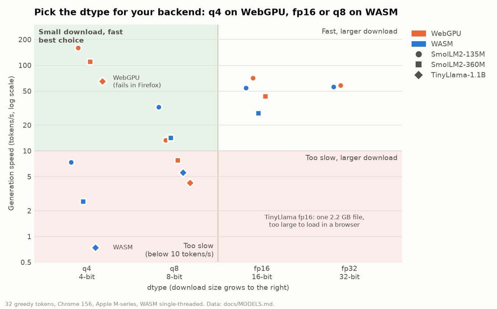

# Models for `lmlite`

This file lists browser-friendly models that are good candidates for `lmlite` (Transformers.js v4 runtime), which of them were actually run for each task, and their licences. Bare `.onnx` files that Transformers.js cannot load are covered at the end of the task pipelines.

`lmlite` accepts either:
- full model IDs (for example: `Xenova/gpt2`, `my-org/my-model`)
- short names (for example: `gpt2`), which default to `Xenova/<name>`

## Semantic similarity (embeddings)

1. [`Xenova/all-MiniLM-L6-v2`](https://huggingface.co/Xenova/all-MiniLM-L6-v2)  
   Lightweight English sentence embeddings for semantic search, similarity ranking, and grouping short texts. A good starting point for browser demos where download size and latency matter. It represents meaning rather than generating answers; long documents should be split into shorter passages.
2. [`Xenova/all-mpnet-base-v2`](https://huggingface.co/Xenova/all-mpnet-base-v2)  
   English sentence embeddings for semantic retrieval and similarity ranking when quality matters more than model size. It generally offers stronger embeddings than MiniLM at the cost of a larger download, more memory, and slower inference. Compare retrieval results on your own data before choosing it; it is not a multilingual default. Avoid its q8 weights: they average `0.1` cosine error against fp32 (see [NATIVE.md](NATIVE.md)); use `embedding_dtype="fp16"`.

### Embedding dtype selection

`LLM.create(embedding_model=..., embedding_dtype="q8")` selects that embedding
dtype only, without retrying another variant if loading fails. When
`embedding_dtype` is omitted or `None`, Transformers.js chooses its default dtype.
The generation/classification settings `dtype` and `dtype_fallbacks` never
override this setting; `backend` also applies only to generation/classification.
Use `embedding_backend="wasm"` or `"webgpu"` to select the embedding device
independently. The default, `None`, retains Transformers.js's default device
selection and does not inherit `backend`. Unsupported device/model/dtype
combinations fail initialization without retrying on another backend.

```python
from lmlite import LLM

llm = await LLM.create(
    embedding_model="Xenova/all-MiniLM-L6-v2",
    embedding_dtype="q8",
)
vector = await llm.embed("A short sentence to compare.")
```

Choose a dtype actually supported by the model's ONNX export and runtime. For
hosted models, include the matching weights and any external data files in the
bundle; `embedding_dtype="q8"` typically selects `onnx/model_quantized.onnx`,
while `"fp32"` typically selects `onnx/model.onnx`. Missing required files fail
loading rather than falling back to a different dtype or Hub copy.

`embed()` uses attention-mask-weighted mean pooling and L2 normalization to return
a flat sentence vector. When comparing browser embeddings against precomputed
vectors, match the model snapshot, weights/dtype, tokenizer, input preparation,
pooling, and normalization. Follow model-card requirements for prefixes such as
E5's `query: ` and `passage: `; lmLite does not add these automatically.
Pinning dtype reduces one source of drift, but does not guarantee bit-identical
results across runtimes. Regenerate stored vectors and recalibrate thresholds
when changing these settings.

## Text classification

1. [`Xenova/distilbert-base-uncased-finetuned-sst-2-english`](https://huggingface.co/Xenova/distilbert-base-uncased-finetuned-sst-2-english)  
   English sentiment classifier with `POSITIVE` and `NEGATIVE` labels, useful for quick demos on reviews or short feedback. Its training is based on movie-review sentiment, so performance may differ on other domains. It has no neutral label and should not be used as a general-purpose topic classifier.
2. [`Xenova/bert-base-multilingual-uncased-sentiment`](https://huggingface.co/Xenova/bert-base-multilingual-uncased-sentiment)  
   Product-review sentiment classifier that predicts one to five stars for English, Dutch, German, French, Spanish, and Italian text. Useful for multilingual review-rating demos rather than binary sentiment. It is heavier than DistilBERT; star ratings should not be treated as reliable measures for unrelated domains or unsupported languages.
3. [`Xenova/toxic-bert`](https://huggingface.co/Xenova/toxic-bert)  
   English comment classifier for toxicity-related labels such as toxic, obscene, threat, insult, and identity hate. Useful for exploring moderation signals, not for automatically deciding whether a person or comment is harmful. Labels can overlap, and predictions can be biased or miss context; use human review for consequential decisions.

Use these with:

```python
llm = await LLM.create(classification_model="toxic-bert")
labels = await llm.classify("example text", top_k=2)
```

## Task pipelines (for `LLM.pipeline(task, model=...)`)

Transformers.js only runs models with ONNX weights and a browser-supported architecture. Models in the `Xenova` and `onnx-community` namespaces usually work, but a model's task and architecture decide, not its namespace: an unsupported architecture fails at load with `Unsupported model type`. `LLM.model_task(model)` returns the Hub's task for a model, and `LLM.model_info(model, task=...)` lists its files and download size before you load it.

Each task below was run with the model in the table, in a real browser, by the opt-in tests named in the last column (see [DEVELOPMENT.md](DEVELOPMENT.md)). "Tested" means that and nothing more: other models of the same task are likely to work but have not been tried here. Licences are the ones the Hub lists for the Xenova repository or its base model, as of November 2026; read the model card before shipping.

| Task | Tested model | Licence | Tests |
|------|--------------|---------|-------|
| `zero-shot-classification` | [`Xenova/mobilebert-uncased-mnli`](https://huggingface.co/Xenova/mobilebert-uncased-mnli) | none stated on the Hub | `task-smoke`, `map-smoke` |
| `translation` | [`Xenova/opus-mt-en-fr`](https://huggingface.co/Xenova/opus-mt-en-fr) | Apache-2.0 | `task-smoke` |
| `automatic-speech-recognition` | [`Xenova/whisper-tiny.en`](https://huggingface.co/Xenova/whisper-tiny.en) | Apache-2.0 | `task-smoke` |
| `text-to-speech` (or `text-to-audio`) | [`Xenova/mms-tts-eng`](https://huggingface.co/Xenova/mms-tts-eng) | **CC-BY-NC-4.0: non-commercial use only** | `speech-smoke` |
| `image-classification` | [`Xenova/vit-base-patch16-224`](https://huggingface.co/Xenova/vit-base-patch16-224) | Apache-2.0 | `task-smoke`, `map-smoke` |
| `zero-shot-image-classification` | [`Xenova/clip-vit-base-patch32`](https://huggingface.co/Xenova/clip-vit-base-patch32) | MIT | `task-smoke` |
| `image-feature-extraction` | [`Xenova/dinov2-small`](https://huggingface.co/Xenova/dinov2-small) | Apache-2.0 | `task-smoke` |
| `object-detection` | [`Xenova/detr-resnet-50`](https://huggingface.co/Xenova/detr-resnet-50) | Apache-2.0 | `task-smoke`, `vision-notebook-smoke` |
| `background-removal` | [`Xenova/modnet`](https://huggingface.co/Xenova/modnet) (6.6 MB quantized) | Apache-2.0 | `image-output-smoke` |
| `depth-estimation` | [`onnx-community/depth-anything-v2-small`](https://huggingface.co/onnx-community/depth-anything-v2-small) (27 MB quantized) | Apache-2.0 | `image-output-smoke` |
| `image-segmentation` | [`Xenova/detr-resnet-50-panoptic`](https://huggingface.co/Xenova/detr-resnet-50-panoptic) (44 MB quantized) | Apache-2.0 | `image-output-smoke` |
| `image-to-image` | [`Xenova/swin2SR-lightweight-x2-64`](https://huggingface.co/Xenova/swin2SR-lightweight-x2-64) (7 MB quantized) | Apache-2.0 | `image-output-smoke` |

### Notes on the tested models

- **`Xenova/mobilebert-uncased-mnli`**: small English NLI model that scores arbitrary candidate labels. It is fast enough for interactive demos. Short, distinct labels work best, and scores are relative to the labels you supply, not calibrated probabilities. For better accuracy, use larger NLI models such as `Xenova/distilbert-base-uncased-mnli` or `Xenova/nli-deberta-v3-xsmall`.
- **`Xenova/opus-mt-en-fr`**: compact Marian model for one language pair. Other pairs use the same naming (`Xenova/opus-mt-<src>-<tgt>`). Multilingual models such as `Xenova/nllb-200-distilled-600M` take `src_lang`/`tgt_lang` arguments, but they are much larger.
- **`Xenova/whisper-tiny.en`**: English-only Whisper, about 40 MB quantized. `Xenova/whisper-tiny` and `Xenova/whisper-base` are multilingual and accept `language` and `task="translate"` arguments. Larger Whisper models are more accurate, but slow and memory-heavy in a browser. It transcribes a file or URL. The microphone notebook feeds it a recording from `lmlite.audio.AudioRecorder` (a 16 kHz WAV), but no test transcribes a real recording.
- **`Xenova/mms-tts-eng`**: a VITS model with one English voice and 16 kHz output, with `model.onnx`, `model_fp16.onnx` and `model_quantized.onnx` files. A hosted copy (`hosted_models_url`, see [USAGE.md](USAGE.md#hosted-models-discovery)) needs `config.json`, `tokenizer.json`, `tokenizer_config.json`, `vocab.json`, `special_tokens_map.json`, `added_tokens.json`, `quantize_config.json` and `onnx/model_quantized.onnx` (38 MB); the `speech-smoke` tests load exactly that from a local server, with no request to the Hub. Other MMS languages follow the same naming (`Xenova/mms-tts-<language>`) and carry the same non-commercial licence.
- **`Xenova/vit-base-patch16-224`**: the 1,000 ImageNet classes. **`Xenova/detr-resnet-50`** names the 80 COCO object classes (people, cats, dogs, bicycles, buses, chairs, and so on); anything else in a photo is not detected. **`Xenova/dinov2-small`** returns one vector per image (the first, CLS, token), because its export has no pooler layer. **`Xenova/clip-vit-base-patch32`** ranks labels you choose at call time. **`Xenova/modnet`** returns a cut-out with an alpha channel, **Depth Anything V2 small** a depth image plus raw values, **`Xenova/detr-resnet-50-panoptic`** one mask per segment (the COCO panoptic classes, things and stuff such as sky and wall), and **Swin2SR** a 2x upscale padded to its window, so slightly wider than twice the input.

### Untested, and known not to work

- **Expected to work, not tried here**: `Xenova/siglip-base-patch16-224` (zero-shot image classification, Apache-2.0) and `Xenova/yolos-tiny` (object detection, Apache-2.0).
- **`Xenova/speecht5_tts`** (MIT) does not run in Transformers.js 4.3.2: the first call fails with "Missing the following inputs: speaker_embeddings, encoder_hidden_states, output_sequence", with `fp32` and `q8`, and with the speaker embeddings given as a URL or a `Float32Array`.
- **Kokoro** (`onnx-community/Kokoro-82M-v1.0-ONNX`, Apache-2.0) is not supported by the pipeline: "Unsupported model type style_text_to_speech_2". It needs the separate `kokoro-js` package, which lmlite does not wrap.
- **MusicGen** and other sound generation (`text-to-audio` with music models) were not tried. The Xenova MusicGen models are CC-BY-NC-4.0.
- **Other image-output models**: `briaai/RMBG-1.4` (background removal) has a licence of `other` on the Hub, `Xenova/segformer-b0-finetuned-ade-512-512` derives from NVIDIA's segformer, also `other`, and `Xenova/dpt-hybrid-midas` is 533 MB: none was tried. Mask generation (SAM) is a different task and is not supported.
- **Native backend**: no pipeline task runs there. `LLM.pipeline()` raises `NotImplementedError`.

## Bare ONNX models (for `OnnxModel.load(...)`)

`OnnxModel` runs a single `.onnx` file with onnxruntime-web (WASM or WebGPU) or, outside a browser, onnxruntime. It does not need a Hugging Face repository, a `config.json` or a tokenizer, so the Transformers.js limits above do not apply: a model runs if onnxruntime-web (or onnxruntime) supports its operators, and you write the pre- and post-processing in NumPy. These were run:

| Model | What it is | Licence | Where |
|-------|-----------|---------|-------|
| [UltraFace `version-RFB-320.onnx`](https://github.com/Linzaer/Ultra-Light-Fast-Generic-Face-Detector-1MB) | 1.2 MB face detector, `(1, 3, 240, 320)` float32 in, scores and boxes out | MIT | `ch08c_onnx-models.ipynb`, `onnx-notebook-smoke` |
| `tests/fixtures/onnx/scale_add.onnx` and `scale_add_fp16.onnx` | 150-byte `y = x * 2 + b` models with a dynamic batch dimension | repository licence | `onnx-smoke`, `xeus-onnx-smoke` |

Limits: a model with external data files (`.onnx_data`) is not supported, and the whole file must fit in browser memory (a single file over 2 GB cannot load at all). `float16` models run on WASM, and on WebGPU only where the adapter has `shader-f16`. The licence of a bare `.onnx` file is often missing: pass `licence="..."` to `OnnxModel.load()` and read it back from `model_info()`. Some popular detector weights are for non-commercial research only, so check before you ship one.

To host a bare model with a site, put it at `files/models/<namespace>/<model>/model.onnx` and list `<namespace>/<model>` in the site's `files/models/manifest.json`; `OnnxModel.load("<namespace>/<model>")` then loads it. See [USAGE.md](USAGE.md).

## Text to image: a recipe, not a pipeline task

Transformers.js 4.3.2 has no text-to-image task, so `LLM.pipeline()` cannot offer one. [`ch08g_text-to-image.ipynb`](../notebooks/ch08g_text-to-image.ipynb) runs a diffusion model with `OnnxModel` instead: the CLIP tokenizer through `LLM.tokenizer`, three ONNX models on WebGPU, and the scheduler in NumPy.

| Model | Licence | Files |
|-------|---------|-------|
| [`schmuell/sd-turbo-ort-web`](https://huggingface.co/schmuell/sd-turbo-ort-web) (SD-Turbo, float16) | **Stability AI Non-Commercial Research Community License**: research and non-commercial use only, no production use, no offering it through a hosted service | `unet/model.onnx` 1,733 MB, `text_encoder/model.onnx` 681 MB, `vae_decoder/model.onnx` 99 MB |

The licence text says that merely distributing the weights for download (as the Hub does) is not a violation, and that offering them through your own hosted service is. Do not bundle them into a site you publish (`jupyterlite -m`); the notebook downloads them from the Hub into the reader's browser. I am not a lawyer: read the licence before you use it.

### Measured

Apple M-series Mac with 18 GB, Chromium on the Metal GPU (`shader-f16`, 4 GB buffers), Pyodide 0.29, onnxruntime-web 1.31 dev, weights served from the same machine, 512 x 512 output, one denoising step. Memory is the sum of the resident memory of every browser process, sampled twice a second. Each figure is a range over three runs on one machine.

| | |
|:--|:--|
| Download from the Hub | 2.4 GB, 7 minutes on the test network |
| Load | text encoder 2.1 to 2.6 s, UNet 7.0 to 8.2 s, decoder 0.4 to 0.5 s |
| First image | 2.8 to 4.3 s over three runs (shader compilation included); in the run with the stages split out: text encoder 0.2, UNet 1.8, decoder 1.8 |
| Next images | 2.5 to 3.4 s |
| Peak browser memory | 6.6 to 7.2 GB: the renderer 6.2 to 6.6 GB, the GPU process about 1 GB (GPU memory on Apple silicon is shared and mostly not in these figures) |
| JavaScript heap | 1.8 to 1.9 GB used, of a 3.8 GB limit |
| WebAssembly backend | fails to load the UNet: `failed to allocate a buffer of size 1733430199` |
| Software WebGPU adapter (default headless Chromium) | fails: `Program Transpose requires f16 but the device does not support it` |
| `OnnxModel.load(..., cache=True)` for the UNet | nothing was stored in the Cache API of the test browser's profile (an incognito-like profile with a small quota), so the file is downloaded again on each new kernel; a normal profile was not tested |

### Decision

**Keep it as a documented recipe. Do not add a `text-to-image` task to `LLM.pipeline()`, and do not drop it.** It works well where the hardware allows it, but a task would promise what lmlite cannot check:

- It needs a hardware GPU with float16 shaders and 1.7 GB buffers, and about 7 GB of browser memory: a recent laptop, not most phones, tablets or machines without such a GPU. The same notebook would fail on WebAssembly and on a software adapter.
- The 2.4 GB download repeats on every kernel unless the browser stores it; a 1.7 GB file did not fit the Cache API in the test profile.
- The model shown is licensed for non-commercial research only, which rules out lmlite shipping or hosting it.
- Every model family has its own tokenizer padding, scheduler and decoder scaling (here: pad token `!`, Euler with `trailing` spacing, latents scaled by 0.18215), so a task would need one implementation per family.

Revisit it if a model with a permissive licence and a smaller footprint appears, or if Transformers.js adds a text-to-image pipeline. Not tried: [`danyalmalik/bk-sdm-small-2m-ONNX-WebGPU`](https://huggingface.co/danyalmalik/bk-sdm-small-2m-ONNX-WebGPU) (OpenRAIL-M, 1.4 GB, but about 25 steps with guidance); `lwanming/sd-turbo-ort-web`, which the Hub tags `openrail` but which holds the same SD-Turbo weights (a repackaged copy's tag does not change the licence); and `stabilityai/sdxl-turbo` (`other`).

## Text generation (for `LLM.create(generator_model=...)`)

1. [`Xenova/gpt2`](https://huggingface.co/Xenova/gpt2)  
   English text-completion model for continuing a supplied passage, exploring sampling settings, and demonstrating browser inference. It is not instruction-tuned: a question or command may be continued rather than answered. Expect repetition and invented facts; it is a baseline for generation demos, not a reliable assistant.
2. [`Xenova/distilgpt2`](https://huggingface.co/Xenova/distilgpt2)  
   Smaller, distilled GPT-2 variant for lightweight English text-completion demos where download size and inference cost matter. It trades generation quality for a smaller model and shares GPT-2's lack of instruction tuning. Prefer it for simple continuation experiments, not factual question answering or structured extraction.
3. [`Xenova/TinyLlama-1.1B-Chat-v1.0`](https://huggingface.co/Xenova/TinyLlama-1.1B-Chat-v1.0)  
   Compact LLaMA-family chat model for conversational responses and simple instruction-following experiments. At 1.1 billion parameters it still needs substantially more browser memory than GPT-2 or SmolLM2-360M; download size depends on the chosen ONNX dtype. Use the model's intended chat format for best results, and expect limitations in reasoning and factual accuracy.
4. [`HuggingFaceTB/SmolLM2-360M-Instruct`](https://huggingface.co/HuggingFaceTB/SmolLM2-360M-Instruct)  
   Compact instruction-tuned model for lightweight English tasks such as short responses, simple rewriting, and basic extraction or classification through prompts. Its small size makes it a candidate for browser demos with limited memory. The `model_q4.onnx` variant shown below is the fastest on WebGPU but slow on WASM; see [Generation dtype selection](#generation-dtype-selection). Do not rely on it for complex reasoning, factual accuracy, or consistently valid structured output; validate generated results.

### Generation dtype selection

The fastest dtype depends on the backend, and the two backends want opposite choices:

- **WebGPU: use `q4`.** It is the fastest variant on every model measured (`q4f16`, where available, was as fast), 10 to 15× faster than `q8`. `q8` is the slowest WebGPU choice, slower than `q8` on WASM, yet it is first in the default fallback order: pass `dtype="q4"` with `backend="webgpu"`. Firefox cannot run 4-bit models on WebGPU (its 9-storage-buffer limit is one short of what the kernels need); use `fp16` there.
- **WASM: avoid `q4`.** WASM 4-bit kernels are 4 to 8× slower than `q8` and 7 to 11× slower than `fp16`. Use `fp16` when the model's fp16 file is under 2 GB (it runs as fast as fp32 at half the download), otherwise `q8`, which is first in the default fallback order. A single file over 2 GB cannot load in a browser at all (`ArrayBuffer size exceeds the supported range`).

<picture>
  <source media="(prefers-color-scheme: dark)" srcset="generation-dtype-speed-dark.png">
  
</picture>

The chart is regenerated with `uv run scripts/plot_generation_dtypes.py`. The same data:

Seconds to generate 32 greedy tokens in Chrome 156 on an Apple M-series Mac (WASM single-threaded, models served locally, so download time is excluded). Sizes in parentheses are the q4 / q8 / fp16 / fp32 files:

| model | backend | `q4` | `q8` | `fp16` | `fp32` |
|---|---|---|---|---|---|
| SmolLM2-135M-Instruct (182 / 137 / 270 / 540 MB) | WASM | 4.35 | 0.98 | **0.59** | 0.57 |
| | WebGPU | **0.20** | 2.39 | 0.45 | 0.55 |
| SmolLM2-360M-Instruct (388 / 365 / 725 MB) | WASM | 12.5 | 2.25 | **1.16** | |
| | WebGPU | **0.29** | 4.12 | 0.74 | |
| TinyLlama-1.1B-Chat (910 / 1101 / 2200 MB) | WASM | 43.1 | **5.72** | too large | |
| | WebGPU | **0.49** | 7.58 | too large | |

The WASM pattern is the same in other browsers. SmolLM2-135M on WASM takes 4.9 / 1.0 / 0.69 / 0.61 s in Safari 26.6 and 4.6 / 1.2 / 0.58 / 0.56 s in Firefox 159 (q4 / q8 / fp16 / fp32). On WebGPU, Safari takes 0.58 s with `q4` and 5.8 s with `q8`. The sizes give one more reason to skip 4-bit on WASM: these `q4` files are not much smaller than `q8`, and for SmolLM2-360M they are larger.

## Downloading and bundling models

Use `LLM.chat(messages)` for conversational models. Transformers.js applies the
chat template from the loaded tokenizer configuration; lmLite returns only the
assistant response. Include the model's `tokenizer_config.json` when hosting or
bundling assets. If no template is present, chat uses generic role labels rather
than a guessed model-specific format. Template errors and unsupported roles are
surfaced, not silently replaced with generic formatting.

The `hf` Pixi task downloads files into `models/<namespace>/<model>/`. Without a file selection it downloads the complete repository, including all ONNX variants, which can be much larger than necessary. Pass filenames after `--` to download only the assets for the dtype you intend to use.

### Minimal GPT-2 download (fp32)

Download the configuration, tokenizer, and one fp32 ONNX model (about 501 MB of weights):

```bash
pixi run hf Xenova/gpt2 -- \
  config.json generation_config.json \
  tokenizer.json tokenizer_config.json \
  onnx/model.onnx
```

Load with `generator_model="Xenova/gpt2", dtype="fp32"`. You do not need the older `decoder_*` files or other ONNX variants.

### Minimal DistilGPT-2 download (fp32)

Download the configuration, tokenizer, and one fp32 ONNX model:

```bash
pixi run hf Xenova/distilgpt2 -- \
  config.json generation_config.json \
  tokenizer.json tokenizer_config.json \
  onnx/model.onnx
```

Load with `generator_model="Xenova/distilgpt2", dtype="fp32"`. As with GPT-2, the older `decoder_*` files and other ONNX variants are not needed.

### Minimal TinyLlama download (q4)

Download the configuration, tokenizer, and one q4 ONNX model (about 910 MB of weights):

```bash
pixi run hf Xenova/TinyLlama-1.1B-Chat-v1.0 -- \
  config.json generation_config.json \
  tokenizer.json tokenizer_config.json \
  onnx/model_q4.onnx
```

Load with `generator_model="Xenova/TinyLlama-1.1B-Chat-v1.0", dtype="q4"`. This variant does not require a separate `.onnx_data` file. The q4 variant has not been confirmed by the earlier browser smoke run, which used the default dtype fallback order.

### Minimal SmolLM2 download (q4)

q4 suits `backend="webgpu"`. For WASM, download `onnx/model_fp16.onnx` instead and pass `dtype="fp16"` (see [Generation dtype selection](#generation-dtype-selection)).

```bash
pixi run hf HuggingFaceTB/SmolLM2-360M-Instruct -- \
  config.json generation_config.json \
  tokenizer.json tokenizer_config.json \
  onnx/model_q4.onnx
```

Load with the matching model ID and dtype:

```python
llm = await LLM.create(
    generator_model="HuggingFaceTB/SmolLM2-360M-Instruct",
    dtype="q4",
)
```

These selections use the complete `tokenizer.json`, so separate `vocab.json`, `merges.txt`, and `special_tokens_map.json` files are not needed for these Transformers.js examples. Downloading only an ONNX file is insufficient. Other models or variants may require external ONNX data files; include those when applicable.

Bundling a single dtype requires explicitly selecting it, since the default fallback order does not include every variant. The download commands add files without removing previously downloaded variants; use a clean model directory if you want the bundle to contain only the listed files.

### Build the bundled sites

After downloading the selected models:

```bash
pixi run jupyterlite -m
```

Individual model files are staged under `content-xeus/models/` and `content-pyodide/models/` before each JupyterLite build, which publishes them at the site's HTTP `files/models/<namespace>/<model>/` URLs. `LLM.create(...)` discovers `files/models/manifest.json` and Transformers.js fetches the selected files directly, bypassing the mounted `/drive` filesystem, with browser caching and download progress. To host an existing download tree elsewhere:

```bash
pixi run jupyterlite -M /path/to/models
```

The JupyterLite build hosts individual files only. Runtime loading of existing model ZIPs from `local_models_path` and portable ZIP exports through `export_models()` remain supported.

Model sources require `<namespace>/<model>/config.json` layout; ZIP-only sources are not supported by the build. Sources must remain outside `workspace/`, which the build recreates. Explicitly requested missing or empty sources fail the build. Bundling increases site size; it supplies model files but does not make the entire JupyterLite runtime or its CDN dependencies offline.

Configure your hosting server to apply gzip or Brotli HTTP compression if supported, preserving original model filenames and sending the correct `Content-Encoding` header. No `.gz` assets are required or generated by the build. An uncompressed static server remains supported.

If automatic site discovery is unavailable, pass the absolute models URL as `hosted_models_url` to `LLM.create(...)`. Hosted snapshots support unversioned model names and `@main`; other explicit revisions retain the existing ZIP/Hub behavior. Hosted models do not fall back to Hugging Face for missing required files, so select a dtype you actually downloaded. Clear the browser model cache after updating a hosted snapshot to fetch its new contents.

## Notes

- Tasks and licences: the tested models and their licences are in the task pipeline tables. A model that is not listed may still work, and `LLM.model_info()` shows its files before you download them. A non-commercial licence (for example MMS-TTS) limits what you can ship, whatever lmlite supports.
- Model support depends on Transformers.js v4 runtime support, available ONNX files, selected backend (`backend` for generation/classification, `embedding_backend` for embeddings), and dtype availability in the model repo.
- For generation and classification, the default dtype fallback order is `["q8", "int8", "fp32"]`. Pass `dtype` to select one, or `dtype_fallbacks` to control retry order; a nonempty `dtype_fallbacks` list takes precedence over `dtype`.
- Embeddings use Transformers.js's default dtype unless `embedding_dtype` is set. An embedding pin is independent of the generation/classification dtype settings and never falls back to another dtype.
