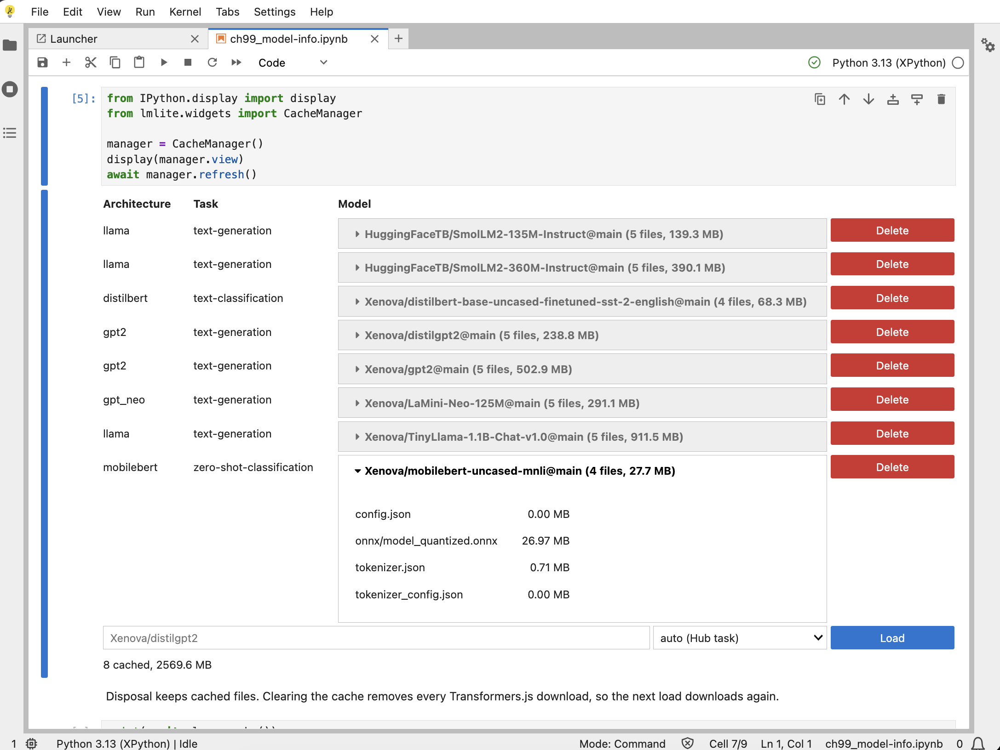

# Models, cache and loading progress

## Hosted Models Discovery

Hosted models are discovered from the browser kernel's JupyterLite URL. If your kernel uses a URL that cannot identify the site root (for example, a blob URL), pass `hosted_models_url="https://your-host/path/to/site/files/models/"` to `LLM.create(...)`.

The site's `files/models/manifest.json` is looked up on every load, and it is optional: a site that hosts no models answers 404 (asked once). A host that answers 5xx or fails the request, as GitHub Pages does now and then, is retried up to three times; if the manifest still cannot be read, lmLite logs a console warning and loads from the Hub, as for a site without hosted models. An explicit `hosted_models_url` is held to a working manifest and raises after the same retries, and a manifest that arrives but is invalid raises in both cases.

Hosted trees represent a single snapshot: explicit revisions other than `@main` use the existing model-resolution path rather than the hosted snapshot. `auto_detect_local=False` disables automatic model-source discovery. Clear the model cache after changing files in a hosted snapshot if you want to force fresh downloads.

```python
# Explicit hosted models URL
llm = await LLM.create(
    generator_model="gpt2",
    hosted_models_url="https://my-site.com/files/models/",
    auto_detect_local=True
)
```

To check where a model would load from without loading it, `await LLM.hosted_base("org/name")` returns the hosted base URL serving that model (for example `"https://my-site.com/files/models/"`), or `None` when it is not hosted. It accepts `hosted_models_url=` and starts the lmLite bridge if needed.

On a site built with `scripts/lite-build.sh`, Transformers.js and its WebAssembly runtime load from the site, so hosted models work where jsDelivr and huggingface.co are blocked. Elsewhere, Transformers.js loads from jsDelivr.

## Model Info, Cache Status and Loading Progress

Inspect a model before loading it:

```python
from lmlite import LLM

info = await LLM.model_info("HuggingFaceTB/SmolLM2-360M-Instruct", backend="wasm", dtype="q4")
print(info.cache_status, info.download_bytes)
for f in info.files:
    print(f["name"], f["size"], f["cached"])

llm = await LLM.create(
    generator_model="HuggingFaceTB/SmolLM2-360M-Instruct",
    backend="wasm", dtype="q4",
    progress_callback=lambda event: print(event),
)
```

`LLM.model_info(model, task=None, backend="wasm", dtype=None)` returns a `ModelInfo` built from the Transformers.js `ModelRegistry`. Pass the `task` you will load (`"text-generation"`, `"feature-extraction"` for embeddings, `"text-classification"`, or a `SUPPORTED_TASKS` entry). Without a task, the model's Hub pipeline tag is used. That needs the network, and a model without a tag reports `task=None` with `error` set. To get only the tag, use `await LLM.model_task(model)`: a single Hub request (5-second timeout) that returns e.g. `"text-generation"`, or `None` offline or for untagged models. `ModelInfo` contains:

- `model_id`, `revision`, `task`, `backend` and `dtype`. Without a dtype, the first of `q8`, `int8` or `fp32` published for the model is reported, matching what `LLM.create()` tries; `feature-extraction` keeps the Transformers.js default and reports `None`.
- `files`: the files the pipeline will fetch, each with `name`, `size` in bytes (or `None`) and `cached`.
- `cache_status`: `"cached"`, `"partial"`, `"not_cached"` or `"unknown"`.
- `download_bytes`: the sum of the file sizes, or `None` if any size is unknown. It is the download size, not an estimate of runtime memory. Runtime memory depends on the backend, the dtype, the browser and the length of what you generate, and lmLite does not estimate it.
- `error`: why the metadata is incomplete, or `None`.

Limitations:

- `cache_status` only reflects the Transformers.js Cache API (`transformers-cache`). It does not inspect the browser HTTP cache, IndexedDB, hosted JupyterLite model files, or ZIPs in `local_models_path`, even though `LLM.create()` can load from any of these.
- When the Cache API is unavailable, for example outside a secure context, `cache_status` is `"unknown"`.
- Offline, sizes of files that are not cached are `None`. If `dtype` is omitted, the dtype lookup needs the network, so you get `cache_status="unknown"` with `error` set. Pass `dtype` explicitly to inspect cached models offline.
- File sizes are read from the cache, or from a 1-byte range request to the Hub. Nothing is downloaded.
- The check works the same in Xeus-Python and Pyodide; it runs entirely in the browser JS runtime.

`progress_callback` receives dicts with `model`, `status`, `file`, `loaded` and `total`:

- `status` is `"initializing"`, `"loading"`, `"progress"` (byte counts for `file`), `"warming up"`, `"ready"` (all models loaded) or `"error"`.
- An `"error"` event also has an `error` message. The exception is still raised.
- The tqdm progress bar keeps working alongside the callback.
- Reading a local ZIP archive is shown only in the progress bar.

## Portable ZIP Import and Export

ZIP archives are a separate portability feature, not an input to the JupyterLite hosting build. Export all models configured on an instance from the browser cache:

```python
await llm.export_models()
```

Exports are saved under `/drive/models/` as `model-<namespace>-<model>@<revision>.zip` and can be downloaded from JupyterLite. Without an explicit revision, naming uses the latest Hub commit when available, otherwise `main`; full commit SHAs are shortened to six characters.

Existing model archives can be imported through `LLM.create(...)`'s `local_models_path` option when no hosted model is selected. Its default is `"/drive/models"`. Opening an archive may fetch the entire compressed file before ZIP-reading progress begins; entries are then read and cached one file at a time.

For preparing a hosted site, prefer the individual-file download workflow above. The current Python export API produces ZIPs; it does not expose a directory-export option.

## Release Loaded Models

```python
await llm.dispose()
```

This releases loaded generation, embedding, and classification pipelines without deleting cached model files. Use it between model trials to release inference sessions and GPU resources. Await all active loading/inference/export operations first; concurrent use and disposal of the same instance are not supported.

Repeated disposal is safe. Cleanup is attempted for every loaded pipeline; failures raise an error, and failed pipelines remain available for a disposal retry. Successfully disposed pipelines reject subsequent inference calls. Create a new instance with `LLM.create(...)` to load models again from cache. Actual memory reclamation timing depends on the browser and runtime; disposal does not guarantee an immediate drop in reported memory.

## Clear Browser Model Cache

```python
from lmlite import clear_cache

result = await clear_cache()
print(result)
```

This clears all cached model files from the browser's cache. Use this if you need to force re-downloading models or if you're experiencing cache-related issues.

To see what is cached, or to remove a single model (all revisions):

```python
from lmlite import cached_models, clear_cache

for entry in await cached_models() or []:
    print(entry["model_type"], entry["task"], entry["model_id"], entry["revision"], entry["size"])

await clear_cache(model="Xenova/gpt2")  # {"model_id": ..., "deleted_files": [...]}
```

`cached_models()` only lists the Transformers.js browser Cache API (not hosted model files or `/drive/models` ZIPs). It returns `None` if the Cache API is unavailable, and `size` is `None` when a file's size is unknown. `file_sizes` maps each file name to its size (`None` if unknown). `model_type` is the architecture from the cached `config.json` (e.g. `gpt2`, `bert`). `task` is the Hub pipeline tag (e.g. `text-generation`) and needs the network, so it is `None` offline. A cache manager widget built on these ships with lmLite and is demonstrated in `notebooks/ch99_model-info.ipynb`; clicking a model name expands its cached files and sizes:

```python
from IPython.display import display
from lmlite.widgets import CacheManager

manager = CacheManager()
display(manager.view)
await manager.refresh()
```


